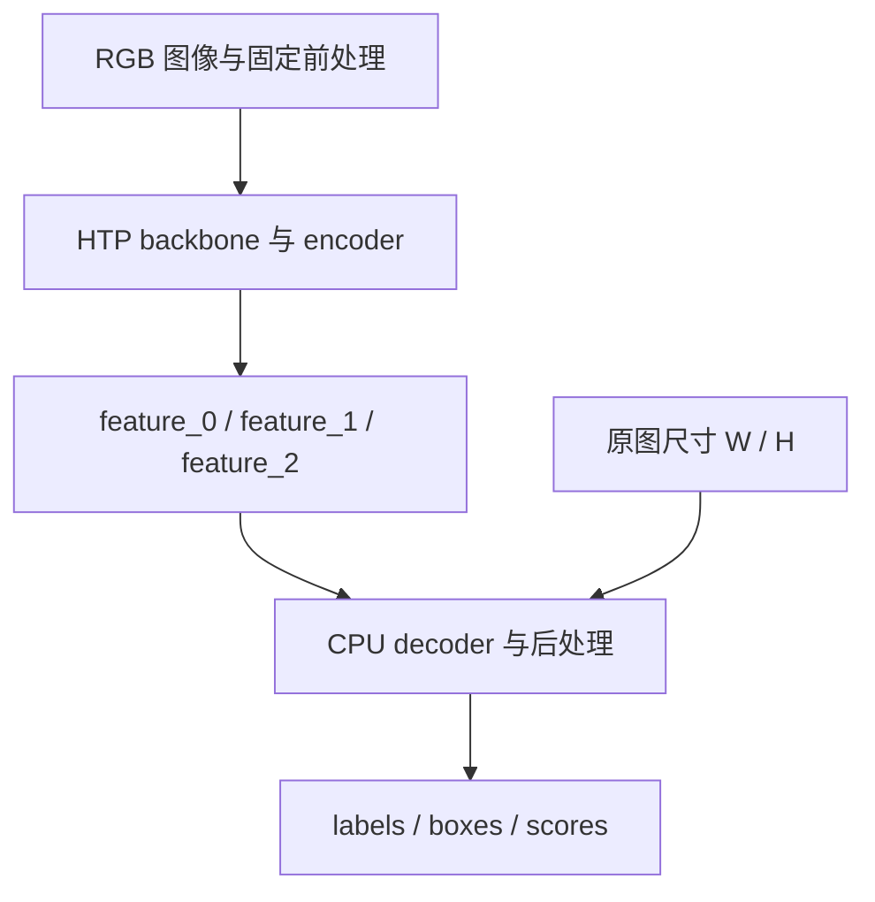

# Qualcomm HTP 上 DEIM 的数值误差与拆图

DEIMv2-S 在 QCS9075 上可以完成整图 HTP FP16 推理，Session 创建和执行都成功，但检测分数明显偏离 CPU 参考。同一张输入的最高检测分数从 0.9573 降到约 0.314，按 0.5 阈值筛选时，CPU 参考中的有效目标会被漏掉。

最终采用 HTP backbone/encoder 与 CPU decoder/postprocessor 的显式拆分。早期固定输入对照中，scores 余弦恢复到 0.999916；后续从 PTH 重新导出、固化 EPContext 的实机回归中，scores 余弦为 0.999915，有效框 IoU 为 0.999683，整链推理中位延时约 79.49 ms。

这个结果来自几组相互约束的实验：先确认输入输出契约，再做正反向拆分；在固定特征上定位 decoder 误差，用真实中间张量检查敏感计算，最后核对 CPU 回退和实际执行位置。单算子的误差、整图的检测结果和执行设备，需要分别验证。

# 一、先固定参考链路

本次归档环境为 QCS9075、HTP v73、VTCM 8 MB，软件组合是 QAIRT 2.50.40、QNN EP 2.6.0 与 ONNX Runtime 1.30.0。模型为 DEIMv2 DINOv3 S，opset 17、静态 batch=1，输入尺寸 640×640。以下数值只对应这组模型与运行环境。

这里的 top-1 指单张图输出中最高的检测分数，不是分类准确率，也不是数据集 AP。用它能够直观看到目标是否跌破置信度阈值，但不能代替完整检测评测。

在检查 HTP 之前，先让原始模型和 CPU 导出模型对齐，并保存送入推理引擎的实际张量。本次输入输出约定如下：

| 项目 | 实际约定 |
| --- | --- |
| `images` | float32 `[1,3,640,640]` |
| 图像处理 | RGB、直接 Resize、除以 255、ImageNet Normalize、NCHW |
| `orig_target_sizes` | int64 `[1,2]`，本次导出实现使用 `[W,H]` |
| 输出 | `labels [1,300]`、`boxes [1,300,4]`、`scores [1,300]` |
| CPU 参考 | 同一导出 ONNX、同一输入张量和尺寸元数据 |

DEIM 的输入不能直接套用常见 YOLO Letterbox 流程。`orig_target_sizes` 也不能只凭变量名猜顺序：本次后处理将它重复成 `[W,H,W,H]`，用于缩放 `xyxy` 坐标，所以必须传 `[W,H]`；其他导出包装若交换过顺序，应以对应实现为准。

同样要核对输出名称、顺序和加载产物的哈希。QAI AppBuilder 的精度检查材料特别提醒，context 可能改变 I/O 顺序，其包装层依赖配套元数据恢复映射。使用该路径时应检查映射文件；本文的 ORT 路径则按模型 I/O 名称核对。两条路径都需要先排除布局错位、旧产物或输出配对错误，再讨论硬件数值。

作为这条 CPU 参考的前置步骤，权重选择、骨干前处理和部署态导出检查见 [DEIM 微调中的配置、前处理与权重产物](../models-training/DEIM_微调与产物契约.md)。

# 二、用正反向拆分定位问题

将 backbone 与 encoder 合记为 $E$，decoder 与后处理合记为 $D$。CPU 参考链路为：

$$
y_{\mathrm{ref}} = D_{\mathrm{CPU}}(E_{\mathrm{CPU}}(x))
$$

只比较 CPU 整图和 HTP 整图，无法区分前段特征已经失真，还是后段对近似计算更敏感。因此保留 encoder 的三层输出，构造下面几组对照：

| 实验 | 早期固定输入结果 | 判断依据 |
| --- | --- | --- |
| CPU 整图 | 最高分 0.9573 | 原始参考 |
| CPU encoder → CPU decoder | 与 CPU 整图逐元素一致 | 拆分没有改变当前图的计算结果 |
| HTP 整图 | 最高分约 0.314 | 整图执行成功，但检测结果失效 |
| HTP encoder → CPU decoder | 最高分 0.9575，scores cos 0.999916 | HTP 前段特征可被 CPU 后段使用 |
| 固定 CPU 特征 → HTP decoder | 最高分 0.3823 | 精确前段输入也无法恢复 HTP 后段结果 |

这两组交叉组合回答的是不同问题。$D_{\mathrm{CPU}}(E_{\mathrm{HTP}}(x))$ 接近参考，说明当前样本上 encoder 的误差尚未破坏后续检测；$D_{\mathrm{HTP}}(E_{\mathrm{CPU}}(x))$ 仍然失真，说明 decoder 的 HTP 路径自身就足以产生明显偏差。

因此，继续缩小范围应从 decoder 开始。这个结论不要求 HTP encoder 与 CPU 逐元素一致，也不意味着所有输入上的 encoder 误差都无影响；它说明本次故障无需先归因于前处理或 encoder，已经能在固定特征的 decoder 上独立复现。

CPU 拆图对照是这组实验的前提。若它与原始 CPU 整图都不一致，应先检查截取的张量、常量依赖、输出顺序和后处理，不能用拆错的子图证明 HTP 存在问题。

# 三、从 decoder 输出追到误差传播

对 CPU encoder 生成的同一组三层真实特征，分别运行 CPU 与 HTP decoder，再比较内部张量：

| 位置 | 余弦 |
| --- | ---: |
| `enc_score_head` | 1.000000 |
| `enc_bbox_head` | 0.989981 |
| `pre_bbox_head` | 0.836427 |
| layer0 self-attention | 0.997678 |
| layer0 cross-attention | 0.969637 |
| layer0 norm3 | 0.717081 |
| layer1 / layer2 / layer3 norm3 | 0.461559 / 0.149937 / 0.202610 |
| FDR integral L0 / L3 | 0.951063 / 0.826547 |
| `dec_bbox_head.3` | 0.031965 |

这些结果反映出 bbox、attention、归一化与迭代回归链路中的偏差。表格各行对应不同张量，不能把余弦当成同一尺度的误差相加，也不能仅按数值大小给算子排故障顺序。后级张量的低余弦同时包含上游输入漂移和本级计算误差。

**为什么 decoder 的误差会影响后续层**

DEIMv2 的 decoder 不只是把同一份特征经过四个独立预测头。源码中，当前层的分布回归结果参与生成下一层 reference points，下一层又据此进行 deformable cross-attention 采样；回归分布还会沿层累积。特征数值、参考框位置和下一轮采样位置之间存在反馈。

FDR 中的 Integral 将回归 logits 经过 Softmax，再对投影值求加权和。简化表示为：

$$
p_j = \operatorname{softmax}(z)_j,\qquad d = \sum_j p_j w_j
$$

其中 $w_j$ 是模型生成的投影权重，不必是均匀整数坐标。概率分布的扰动会改变回归距离，继而影响参考框和后续采样。最终的 LQE 还利用回归分布的统计量调整分类 logits，框分布与检测分数也有关联。

RMSNorm、残差、SwiGLU 和门控计算则作用于 decoder 特征。RMSNorm 包含平方、均值、倒平方根及缩放，误差可能改变整个通道向量的归一化比例。上游实现显式在 `.float()` 上计算归一化，再转回输入类型，但导出后由 backend 如何执行，需要另行确认；Python 中写了 FP32 计算，不等于部署内核完整保留了同一路径。

从数值分析上，可以把一层的误差近似分成输入误差传播和本层新增误差：

$$
\delta h_{\ell+1} \approx J_\ell\,\delta h_\ell + \epsilon_\ell
$$

$J_\ell$ 表示当前输入附近的局部敏感性。这个表达式解释了为何末端偏差不能直接归因于末端算子，并不证明误差一定逐层单调增长。TopK、阈值筛选与采样位置变化还可能带来不连续的输出变化，不能只用线性近似预测最终检测结果。

# 四、用真实输入检查敏感计算

逐层导出中间张量用于找范围；要进一步检查某一段计算，需要把它的输入固定下来。对一个局部函数 $f$，整段对照中的差异可以写成：

$$
\widetilde f(\widetilde x)-f(x)
= \left[\widetilde f(\widetilde x)-\widetilde f(x)\right]
+ \left[\widetilde f(x)-f(x)\right]
$$

第一项包含上游输入变化，第二项才是在同一输入上的局部执行差异。实际操作中，保存 CPU 参考产生的真实中间张量，将同一份输入送入 CPU 和 HTP 的独立小图，比直接观察深层输出更容易区分这两类影响。

探针还要保留原来的 shape、归约轴、epsilon、scale、广播关系与常量。随机输入扫描可以发现实现差异，但输入分布不一定代表模型实际范围；最终应回到真实特征。额外暴露中间输出也可能改变融合与编译，因此探针用于定位，修复或拆分后仍需回到实际部署产物验证。

**与最终输出舍入作对照**

本次采用 CPU 参考输出转为 FP16、再转回 FP32 的结果，构造一个简单基线：

$$
e_{\mathrm{round}} = \max\left|\operatorname{FP32}(\operatorname{FP16}(y_{\mathrm{CPU}}))-y_{\mathrm{CPU}}\right|
$$

它表示只在最终输出发生 FP16 舍入时的误差。真实张量探针的记录如下：

| 探针 | HTP 最大绝对误差 | 最终输出 FP16 舍入误差 | 约为基线的 |
| --- | ---: | ---: | ---: |
| RMSNorm norm1 | 4.93e-3 | 9.76e-4 | 5.0 倍 |
| RMSNorm norm3 | 3.33e-3 | 9.58e-4 | 3.5 倍 |
| Self-attention Softmax | 9.54e-3 | 2.43e-4 | 39.2 倍 |
| Cross-attention Softmax | 1.55e-3 | 2.40e-4 | 6.5 倍 |
| FDR Softmax L0/L3 | 约 1.97e-3 | 约 2.38e-4 | 8.3 倍 |

这说明差异不能仅由最终输出的一次 FP16 舍入解释。它并不是完整 FP16 运算的误差上界：输入量化、归约顺序、中间存储和非线性近似都会贡献误差。39.2 倍也只是两组最大误差之比，不表示每个元素都偏离同样倍数，更不能据此反推出闭源 kernel 的累加类型。

Softmax 的归一化检查也需要相同基线。FP16 存储的概率逐项求和，本身就不保证严格等于 1：

| Softmax | 最终输出 FP16 舍入的 sum error | HTP sum error |
| --- | ---: | ---: |
| Self-attention | 4.12e-4 | 1.9e-3 |
| Cross-attention | 2.95e-4 | 1.9e-3 |
| FDR L0 | 2.70e-4 | 1.8e-3 |
| FDR L3 | 2.16e-4 | 1.8e-3 |

比较时沿对应 Softmax 轴计算归一化误差，并同时保留最大误差、均值误差和输出分布。当前记录支持“HTP 在这些真实输入上的局部偏差大于最终输出舍入基线”，尚不能证明 Softmax 或 RMSNorm 是唯一根因。

QNN 官方文档说明，在支持浮点模型的 SoC 上，QAIRT 2.35 之后的 HTP 浮点运算使用 FP16 math。ONNX 中保留 float32 I/O，或者改动 `enable_htp_fp16_precision`，都不能据此获得任意算子的完整 FP32 HTP 计算保证。该说明同样没有公开每一个 kernel 的内部累加与近似实现。

# 五、用反证排除单一算子归因

GELU 的精确表达使用高斯误差函数 Erf：

$$
\operatorname{erf}(x)=\frac{2}{\sqrt{\pi}}\int_0^x e^{-t^2}\,dt,\qquad
\operatorname{GELU}(x)=\frac{x}{2}\left[1+\operatorname{erf}\left(\frac{x}{\sqrt{2}}\right)\right]
$$

因此，导出图中一串缩放、Erf、加法和乘法可能是在表达 GELU。后端可以分别执行这些节点，也可以将它们融合；GELU 还有 tanh 近似形式，比较时需要确认两边实际采用的表达及优化后的计算路径。

Erf 的数学定义相同，内核仍可能在逼近方法、中间精度和运算顺序上不同。以 CANN 的一个公开 `arch35` 实现为例，其 FP16 分支使用 `half` 作为 Erf 计算 DAG 的类型，BF16 分支先转成 `float`，调用向量 Erf 后再转换回输出类型。这里展示的是该实现的类型安排；向量 Erf 的具体内部算法以及 Qualcomm HTP 的实现，不能由这段代码推断。输入和输出的数据类型也不足以单独确定中间运算精度。

固定输入、暂不考虑其他浮点舍入时，若 Erf 的结果偏差为 $\delta e$，传到 GELU 的偏差是 $\delta y=\frac{x}{2}\delta e$。误差发生在哪个输入区间因此很重要：当 $x$ 位于负半轴尾部，$1+\operatorname{erf}(x/\sqrt{2})$ 接近零，有限精度可能使结果提前归零。这时相对误差可能很大，但绝对误差仍然很小，必须结合真实输入分布和后续网络来判断影响。

验证时可先用相同输入比较 Erf 的分段误差和饱和位置，再比较完整 GELU 子图与融合路径，最后将实测误差注入对应位置并观察检测结果。独立探针有助于定位，但提取子图或增加中间输出可能改变融合与精度路径，需要结合原图的执行信息解读。

早期探针发现 GELU/Erf 存在误差，但局部误差较大，不足以说明它造成了最终检测失败。进一步将实测扰动注入 CPU 模型，检测结果没有出现对应变化，因此不能把 GELU/Erf 写成唯一主因，也不能把 GELU 融合写成已经解决问题的方案。

这组实验的价值在于将局部异常与任务影响分开。扰动注入需要说明注入位置、幅度和方式；即使没有复现故障，也只是削弱当前归因，不能证明该算子在所有输入下都无影响。

GridSample 单算子对照的最大绝对误差约为 0.0055，结合固定特征的正反向拆分，没有足够证据把本次问题解释成采样语义错误。它也不能证明 GridSample 的误差贡献严格为零。当前证据更支持 decoder 中多处敏感计算的偏差在迭代结构中共同传播，而不是一个已确认的单点错误。

其他探索路线包括 QNN GPU decoder、u16/u8 QDQ 和 GELU 融合，归档中均未形成最终可交付方案。这里不把“尝试过”写成“普遍不可行”，也不以另加量化后的结果解释原先 FP16 路径中的全部问题。

# 六、为什么 pin 到 CPU 后对齐还不够

QNN 的 `op_affinity` 可以将某类 ONNX 算子配置为 CPU，使其不再由当前 QNN EP 承接。例如：

```json
{
  "op_type": {
    "Softmax": "CPU"
  }
}
```

配置的对象是算子类型，可能同时影响 self-attention、cross-attention 和 FDR 中的多个 Softmax，并不是只替换某一个已定位节点。实际执行还取决于图优化、节点支持情况和重新分区。

当前 QNN EP 源码中的处理顺序是先分析支持节点，再组织可支持的分区并编译。将某类算子排除，会改变剩余候选子图和它们的输入输出；不能把它理解成在既有 HTP 图中原位插入一个 CPU kernel。公开主线源码能够解释这一机制，但不能单独证明归档版本中每一次整图回退的具体原因，仍需对应日志和 profile。

本次回退实验给出了直接反证：

| 配置 | 实际观察 | 能否作为局部修复证据 |
| --- | --- | --- |
| Softmax → CPU | profile 显示 7926 个节点全部由 CPU EP 执行，约 403 ms | 不能，已不是只替换 Softmax |
| Erf → CPU | 没有复现“其余全 HTP 且完全对齐” | 不能据此确认 Erf 是主因 |
| 多算子 pinning | 部分实验产生大量 HTP/CPU 分区，约 243～404 ms | 需要核对分区与跨设备开销，未作交付 |

7926 是该次优化后执行图的记录，不是 DEIMv2 固定的原始算子数量。输出重新对齐，可能只是模型主要部分重新由 CPU 计算；如果不检查执行位置，就会把回退当成数值修复。

**区分三种 CPU 执行**

| 方式 | 实际含义 | 本文的处理 |
| --- | --- | --- |
| ORT CPU EP 自动回退 | QNN 未接管的部分交由 CPU EP 执行 | 探索时记录，HTP 交付段禁止隐式回退 |
| QNN CPU backend | 通过 QNN CPU backend 执行，仍在 QNN 接口体系内 | 不能记为 HTP 性能或 HTP 精度 |
| 显式 CPU decoder | 单独导出 CPU ONNX，应用明确串联两个 Session | 最终部署方案的一部分 |

AppBuilder 随附 skill 中禁止静默 CPU 回退，是对其 HTP 转换验收流程的要求：不能拿 CPU 结果替代失败的 HTP 结果。其转换排障材料也列出了将后处理等部分分离到 CPU 的处理思路。这些工作流要求不能推导为“任何异构部署都不允许 CPU”；关键是是否预先定义执行位置，分别验证并如实统计。

对预期完全运行在 HTP 的 encoder，在创建和重新加载 context 时都关闭 CPU EP fallback：

```python
options.add_session_config_entry("session.disable_cpu_ep_fallback", "1")
```

再结合 ORT provider 分配、QNN profiling 和必要的 framework op trace 核对。`session.get_providers()` 包含 QNN 只代表 Session 注册了这个 provider；执行图中的 QNN 融合节点也不再与原始 ONNX 节点一一对应。归因实验应同时保存原始节点到分区的关系及实际执行记录。

[RKNN 上 DEIM 的采样语义与部署边界](../graphs-operators/RKNN_DEIM部署边界.md) 也记录了回退边界的实际成本，但起点是采样算子的支持与语义问题。两组案例可共同用于检查执行位置和搬运开销，具体切点仍由各自实验决定。

# 七、将稳定切点固化为两个产物

最终切点选在 backbone 与 encoder 之后、decoder 的输入投影和 query 选择之前。三层特征分别对应 1/8、1/16、1/32 尺度，接口命名为 `feature_0/1/2`。decoder 的输入投影、TopK、attention、迭代回归、LQE 和输出后处理整体留在 CPU。



选择这一位置，首先是因为交叉对照已经证明这组三层特征可用；其次是接口明确，跨设备只交接一次前段结果，避免在四层 decoder 的敏感计算之间反复切换。它保留了 CPU decoder 内部连续的数值路径，也使问题更容易复现。

这并不意味着中间特征传输免费。按本次 S 配置的 192 通道和 640 输入计算，三层特征的元素总数为：

$$
192\times(80\times80+40\times40+20\times20)=1{,}612{,}800
$$

若以 float32 暴露给应用，约为 6.15 MiB。这个数是由接口形状计算出的张量大小，不是新增的内存带宽实测；实际拷贝、缓冲区转换和同步开销需要包含在整链计时里。内部 HTP 使用 FP16，也不等于应用收到的特征自动变成 float16。

拆图实现先在原始 ONNX 中确认三个目标输出，再分别提取 encoder 与 decoder 的依赖子图，保留必要常量与尺寸输入，将边界张量重命名为稳定接口。当前脚本通过导出图中的特定张量后缀定位切点，并要求唯一匹配；更换导出器或网络配置后，需要重新检查，不能仅凭文件名相同复用旧切点。

交付形式为：

```text
model-package/
├── encoder_ctx.onnx   # 内嵌 QNN HTP context binary
├── decoder.onnx       # CPU decoder 与后处理
└── manifest.json      # I/O、运行环境、哈希与验证结果
```

encoder 的 EPContext 固化 HTP 执行产物，不能当作普通 CPU ONNX 使用；decoder 明确指定 CPU EP。应用按输出名称组装三层特征，并将原图尺寸传给 decoder。环境安装与插件注册见 [Qualcomm QNN 环境部署与 ABI 排查](../tutorial/Qualcomm_QNN依赖与ABI.md)。

# 八、按任务结果验证，再统计整链代价

检测输出经过 TopK 排序，某一行不一定始终对应同一个候选目标。两个分数非常接近的候选交换顺序后，scores 向量仍可能接近，labels 和 boxes 却在逐行比较中产生很大差异；类别编号的余弦也没有可靠的语义距离含义。

因此验证分成两层。第一层检查特征、scores 和数值误差，保留原始逐行指标用于诊断；第二层按置信度保留有效框，在相同类别中按 IoU 建立一对一匹配，检查未匹配目标、框偏差和分数差。本次实现按 IoU 从高到低贪心匹配，适合编译回归，但不是 COCO AP 评测的替代实现。

2026-10-08 从原始 PTH 重新导出的实机报告如下：

| 检查项 | 结果 |
| --- | ---: |
| CPU 拆图与同次完整 CPU 图 | 逐元素一致 |
| 与历史 CPU 输出匹配的有效框 IoU | 0.9999996 |
| HTP 三层特征余弦 | 0.999787 / 0.999651 / 0.999389 |
| 整链 scores 余弦 | 0.999915 |
| 有效框 IoU | 0.999683 |
| 对应检测分数差 | 0.000199 |
| 按输出行比较的 boxes 余弦 | 0.916024，仅作诊断 |

有效框以置信度 0.25 筛选，该样本参考与实际各保留一个框，完成匹配。boxes 整体逐行余弦偏低而有效框高度重合，说明只保留一个汇总指标容易误判；同样，只有一个有效框的样本也不足以覆盖拥挤场景、低置信目标和类别混淆。

编译流程分别设置检查条件：CPU 导出与历史参考要求 scores cos ≥0.999、有效框 IoU ≥0.99、分数差 ≤0.001；HTP 异构链路要求三层特征和 scores cos ≥0.99、有效框 IoU ≥0.95、分数差 ≤0.05，并核对 Top 类别。这些是当前回归流程的容差，不是模型准确率标准。context 需重新加载并实际执行，模型与参考输入的 SHA-256 一起写入 manifest。

**计时只保留实际部署的两个 Session**

后续实机测试固定 batch=1，CPU decoder 使用 8 个 intra-op 线程、1 个 inter-op 线程和顺序执行模式，HTP 使用 burst 配置；预热 3 次，测量 20 次，报告中位数：

| 阶段 | 中位延时 |
| --- | ---: |
| HTP encoder | 44.95 ms |
| CPU decoder/postprocessor | 34.50 ms |
| 整链 | 79.49 ms |

整链从 encoder 的 `run()` 前开始，到 decoder 的 `run()` 后结束，包括特征交接与相应的运行时开销，不含文件读图和图像前处理。各阶段分别取中位数，其和不必严格等于整链样本的中位数。

计时先只创建实际交付的 encoder 与 decoder Session，完成测量并释放后，再创建 CPU 整图和拆图参考 Session。否则多个 ORT Session 的线程池可能竞争 CPU，干扰 decoder 延时。参考模型正确性测试与部署性能测试使用同一进程并非天然等价，需要控制存活 Session 和线程配置。

早期固化链路记录约 80.29 ms，后续 PTH 导出回归为 79.49 ms，应按各自轮次保留；更早未固化 context 的探索记录约 106.7 ms，也不能直接与后续数值相除，归因为 context 带来的稳态加速。context 可以省去部分运行时图构建，但具体启动和稳态收益需要单独对照。

当前证据确认的是：这组环境下，显式拆分能够恢复所测样本的有效检测，并将设备通信、HTP encoder 和 CPU 后段的代价纳入可重复的整链测试。完整验证集 AP、更多输入分布和持续运行表现仍需分别评测；单图余弦、最高分与一次延时报告不能代替这些结果。

# 九、参考资料

- [DEIMv2：decoder、FDR、RMSNorm 与后处理实现](https://github.com/Intellindust-AI-Lab/DEIMv2/tree/main/engine/deim)
- [PyTorch：GELU 定义与近似形式](https://docs.pytorch.org/docs/stable/generated/torch.nn.GELU.html)
- [CANN Erf：arch35 内核入口与计算 DAG](https://github.com/hicann/ops-math/tree/master/math/erf/op_kernel)
- [QNN EP：浮点精度、op affinity 与 profiling](https://github.com/onnxruntime/onnxruntime-qnn/blob/main/docs/execution_providers/QNN-ExecutionProvider.md)
- [QNN EP 源码：节点支持检查与分区](https://github.com/onnxruntime/onnxruntime-qnn/blob/main/onnxruntime/core/providers/qnn/qnn_execution_provider.cc)
- [QAI AppBuilder：精度检查与输出映射](https://github.com/qualcomm/qai-appbuilder/blob/main/tools/skills/qai-runner-skill/references/accuracy_checking.md)
- [QAI AppBuilder：HTP 转换工作流与 CPU 回退要求](https://github.com/qualcomm/qai-appbuilder/blob/main/tools/skills/qai-runner-skill/SKILL.md)
